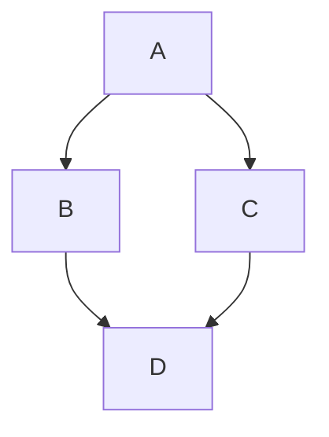

# apk-depgraph

Практическая работа по конфигурационному управлению, вариант 11. Программа строит граф зависимостей
пакета Alpine Linux и выводит его в виде диаграммы Mermaid или ASCII-дерева. Ещё она умеет показывать
порядок, в котором пакеты нужно загружать.

Зависимости программа читает сама из файла APKINDEX.tar.gz нужного репозитория. Менеджеры пакетов и
сторонние библиотеки не используются, только стандартная библиотека Python.

## Как это работает

Программа скачивает индекс репозитория, находит в нём заданный пакет и берёт его прямые зависимости. Потом
то же самое делается для каждой зависимости, пока не закончатся новые пакеты. Обход сделан в глубину
(DFS) с рекурсией. Если пакеты зависят друг от друга по кругу, второй раз они не раскрываются, поэтому
программа не зацикливается.

Есть тестовый режим. В нём вместо адреса репозитория указывается файл, где пакеты называются большими
латинскими буквами. Формат файла простой, одна строка на пакет:

```text
A: B C
B: D
C: D
D:
```

Это значит, что A зависит от B и C, а B и C зависят от D.

## Настройки

Все настройки задаются параметрами командной строки.

| Параметр | Обязательный | Что делает |
|---|---|---|
| `--package` | да | имя пакета, который анализируем |
| `--repo` | да | адрес репозитория (папка, где лежит APKINDEX.tar.gz) или путь к файлу тестового репозитория |
| `--test-mode` | нет | тестовый режим, `--repo` тогда указывает на файл |
| `--ascii-tree` | нет | кроме диаграммы Mermaid вывести ещё ASCII-дерево |
| `--load-order` | нет | вместо графа вывести порядок загрузки зависимостей |
| `--filter` | нет | не учитывать пакеты, в имени которых есть эта подстрока (без пробелов) |

Если параметры неверные, например имя пакета с пробелом, адрес не http и не https, нет файла в
тестовом режиме или в подстроке есть пробел, программа пишет `ошибка: ...` и завершается с кодом 1.

## Функции

Файл `src/config.py`:
- `build_parser` создаёт разборщик параметров командной строки.
- `check_package`, `check_repo`, `check_substring` проверяют имя пакета, адрес репозитория и подстроку.
- `parse_config` разбирает параметры, проверяет их и возвращает объект `Config`.

Файл `src/repository.py`:
- `index_url` делает из адреса репозитория адрес файла APKINDEX.tar.gz.
- `download` скачивает файл по адресу.
- `read_index_text` достаёт текст APKINDEX из архива.
- `parse_entry` и `parse_index` разбирают текст индекса на пакеты.
- `parse_test_repo` и `load_test_repo` читают файл тестового репозитория.
- `load_packages` выбирает, откуда брать пакеты, из интернета или из тестового файла.
- `find_package` ищет пакет по имени и сообщает об ошибке, если его нет.

Файл `src/graph.py`:
- `clean_name` убирает из записи зависимости ограничение версии.
- `build_provides` и `resolve` сопоставляют записи вида `so:libz.so.1` с настоящими пакетами.
- `direct_dependencies` возвращает прямые зависимости пакета с учётом фильтра.
- `visit` и `build_graph` строят граф обходом в глубину.
- `visit_order` и `load_order` считают порядок загрузки.

Файл `src/visualize.py`:
- `mermaid_text` делает описание графа на языке Mermaid.
- `tree_lines` и `ascii_tree` рисуют зависимости в виде ASCII-дерева.

Файл `src/main.py` связывает всё вместе и выводит результат.

## Запуск

Нужен Python 3, ничего устанавливать не надо. Я проверяла на Python 3.13.

На Windows:

```
run.bat --package nginx --repo https://dl-cdn.alpinelinux.org/alpine/v3.20/main/x86_64
```

На любой системе:

```
python src/main.py --package nginx --repo https://dl-cdn.alpinelinux.org/alpine/v3.20/main/x86_64
```

## Тесты

```
cd tests
python -m unittest
```

Для каждого этапа есть скрипт с примерами запуска в папке `scripts`: `stage1_ok.bat`, `stage1_errors.bat`,
`stage2.bat`, `stage3.bat`, `stage4.bat` и `stage5.bat`.

## Примеры

Граф и ASCII-дерево для тестового репозитория:

```
python src/main.py --package A --repo testdata/test_repo.txt --test-mode --ascii-tree
```

```text
graph TD
    n0["A"]
    n1["B"]
    n2["D"]
    n3["C"]
    n0 --> n1
    n0 --> n3
    n1 --> n2
    n3 --> n2

A
|-- B
|   `-- D
`-- C
    `-- D (повтор)
```

GitHub рисует такую диаграмму прямо на странице:



Циклическая зависимость (A зависит от B, B от C, C снова от A):

```
python src/main.py --package A --repo testdata/cycle.txt --test-mode --ascii-tree
```

```text
A
`-- B
    `-- C
        `-- A (повтор)
```

Порядок загрузки настоящего пакета:

```
python src/main.py --package nginx --repo https://dl-cdn.alpinelinux.org/alpine/v3.20/main/x86_64 --load-order
```

```text
1. musl
2. busybox
3. busybox-binsh
4. libcrypto3
5. pcre
6. libssl3
7. zlib
8. nginx
```

Фильтр по подстроке. Пакет D и всё, что тянется только через него, в анализ не попадает:

```
python src/main.py --package A --repo testdata/deep.txt --test-mode --load-order --filter D
```

```text
1. F
2. E
3. C
4. B
5. A
```

## Сравнение с apk и ограничения

Порядок загрузки я сравнила с настоящим `apk add` на Alpine 3.20 для пакетов nginx и curl. Порядок
совпал, но `apk` ставит ещё один пакет, `ssl_client`. Скорее всего, он подтягивается по правилу
`install_if`, а не как зависимость. Программа читает только зависимости (поле `D:` в индексе), поэтому
его не видит.

Что программа не умеет:
- Читается только один индекс, тот, на который указывает `--repo`. Зависимости из других репозиториев,
  например из `community`, пропускаются.
- Ограничения версий (`>=`, `~` и другие) игнорируются, конфликты (`!пакет`) не учитываются.
- Если одно и то же имя (`so:` или `cmd:`) предоставляют несколько пакетов, берётся первый.